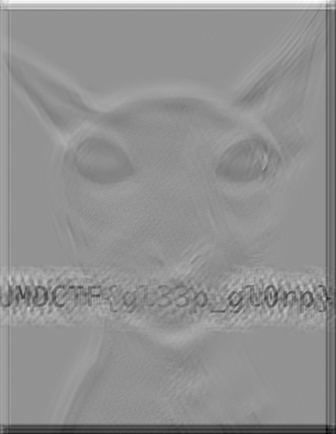

<div align="center">

# UMDCTF 2025 write-ups

**My solves from UMDCTF 2025: fourteen challenges across pwn, reverse engineering, crypto, misc and OSINT, each with the files and a reproducible solver.**




</div>

Each folder holds the challenge files, a write-up and, where it makes sense, a script that
reproduces the solve. All flags are `UMDCTF{...}`. Several challenges talked to servers that are
offline now; for those the write-up says so and shows the part that still runs locally.

| challenge | category | what it is | technique |
|---|---|---|---|
| [alien-transmission](alien-transmission/) | misc | flag image blurred by a random kernel | rebuild the seeded kernel, center-boost deconvolution |
| [deobfuscation](deobfuscation/) | rev | password-checker ELF, all syscalls | the password is `expected XOR key`, both in `.data` |
| [square-up](square-up/) | crypto | Rabin with a buggy decrypt branch | the wrong square root leaks `p` via `gcd(M_bug^2 - c, N)` |
| [obsidian-block](obsidian-block/) | crypto | 24-round add-key-then-rotate cipher | key cancels in a known-plaintext difference |
| [find the seeds](find%20the%20seeds/) | crypto | XOR keystream from `random`, seeded by the clock | brute-force the timestamp seed |
| [gambling2](gambling2/) | pwn | 32-bit guessing game, `%lf` into `float[4]` | overwrite the return address with a crafted double |
| [unfinished](unfinished/) | pwn | 128-byte global, `fgets(buf, 500, ...)` | overwrite `__new_handler`, failed `new` runs a shell |
| [tiktok-ban](tiktok-ban/) | misc | case-sensitive DNS filter on tiktok.com | query `TiKToK.com` |
| [tiktok-ban-revenge](tiktok-ban-revenge/) | misc | the filter now lowercases | split the name with a DNS compression pointer |
| [beauty](beauty/) | osint | Google Maps panorama | find the uploader |
| [sunshine](sunshine/) | osint | garbage truck, house 356, Summit County | query the county GIS address layer |
| [swag-like-ohio](swag-like-ohio/) | osint | a bridge in Ohio | reverse image search |
| [the-master](the-master/) | osint | a historical marker | match it in the hmdb.org marker series |
| [gerard-manley-hopkins](gerard-manley-hopkins/) | osint | a street photo | identify the hauler, read house numbers |

## Highlights

- Three solvers recover the real flag from the files alone: deobfuscation reads its two 52-byte blocks out of the ELF, find-the-seeds brute-forces the timestamp seed in under three seconds, and square-up factors a 768-bit N with a single `gcd`.
- The obsidian-block cipher adds the same key every round, so subtracting two ciphertexts after undoing the rotations cancels the key. Carries at the rotations leave about eight bytes to read by eye.
- Both pwn binaries run locally with a placeholder flag: unfinished redirects a failed `new int[n]` through `__new_handler` into a shell, and gambling2's payload is a single double whose bytes are `print_money`'s address.
- The two TikTok challenges are the same filter tightened once: case-insensitivity beats the first, a forward DNS compression pointer beats the second.

---

## Running the solvers

The scripts need Python 3.10+. The crypto ones use `pycryptodome`; the pwn and rev binaries are
Linux x86 and x86-64. Commands below were run on Ubuntu 24.04 (WSL).

```bash
git clone https://github.com/EllE961/UMDCTF2025Writeup
cd UMDCTF2025Writeup
pip install -r requirements.txt

python3 deobfuscation/solve.py deobfuscation/flag        # reads the flag from the ELF
python3 "find the seeds/solve.py"                        # cd into the folder first, or pass paths
python3 square-up/dec.py                                 # run from square-up/
python3 obsidian-block/solve.py                          # run from obsidian-block/

echo 'UMDCTF{local_test_flag}' > unfinished/flag.txt     # placeholder for the local shell
python3 unfinished/solve.py unfinished/unfinished
```

A couple of scripts read their data from the working directory, so `cd` into the folder before
running them.

## Repository map

```text
alien-transmission/    kernel reconstruction and deconvolution, plus the recovered image
deobfuscation/         syscall-only ELF; solve.py reads the XOR blocks from .data
square-up/             Rabin bug; dec.py factors N and decrypts
obsidian-block/        add-rotate cipher; solve.py does the key-cancelling differential
find the seeds/        timestamp-seeded RNG; solve.py brute-forces the seed
gambling2/             32-bit ret2win; solve.py builds and checks the payload
unfinished/            new-handler overwrite; solve.py runs it locally
tiktok-ban/            case-sensitivity DNS bypass
tiktok-ban-revenge/    compression-pointer DNS bypass
beauty sunshine swag-like-ohio the-master gerard-manley-hopkins   OSINT geolocation
docs/assets/           the deblurred alien-transmission image
```

---

<sub>The challenge files in each folder were authored by the UMDCTF 2025 organizers (University of Maryland Cybersecurity Club). The write-ups and solver scripts are mine.</sub>
