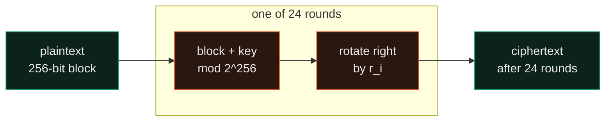

# Obsidian block

UMDCTF 2025, crypto. A Minecraft-themed block cipher that adds the same key every round. Adding
the key identically each round means it cancels in a difference, which breaks the cipher with a
known plaintext.

## The cipher

`dist.py` runs 24 rounds over a 256-bit block. Each round adds the key mod 2^256 and rotates by
a fixed amount:



The key is a random 256-bit value, the same in every round. We are given a known
plaintext/ciphertext pair (`p1 = "please like and subscribe!!!!!!!"`, `c1`) and the flag's
ciphertext `c2`.

## Solve

The rotations are public, so undo all 24 of them on both ciphertexts. Just before each rotation
both messages had the same key added, so in the difference of the two unrotated states the key
cancels and what is left is the difference of the two plaintexts. Add that to the known
plaintext:

```python
a, b = c1, c2
for r in reversed(ROUND_CONSTANTS):
    a, b = inv_rot(a, r % 256), inv_rot(b, r % 256)
diff = (b - a) % M
recovered = long_to_bytes((p1 + diff) % M)
```

Rotation does not commute with subtraction mod 2^256, so a carry here and there flips a bit as
the difference passes back through each rotation. The recovery is right except for about eight
bytes, which are obvious from the `UMDCTF{...}` format and the diamond-pickaxe theme:

```text
$ python3 solve.py
recovered: YMDCTFsdiamon\_p.ckaxu_no_w.i!!.
```

Reading through the carry noise (`Y` is `U`, `s` is `{`, `\` is `d`, `u` is `e`, `i` is `y`,
`.` is `}`):

## Flag

```text
UMDCTF{diamond_pickaxe_no_way!!}
```

## Files

```text
dist.py      the challenge cipher (24 rounds of add-key then rotate)
output.txt   the two ciphertexts c1, c2
solve.py     the key-cancelling differential recovery
```
